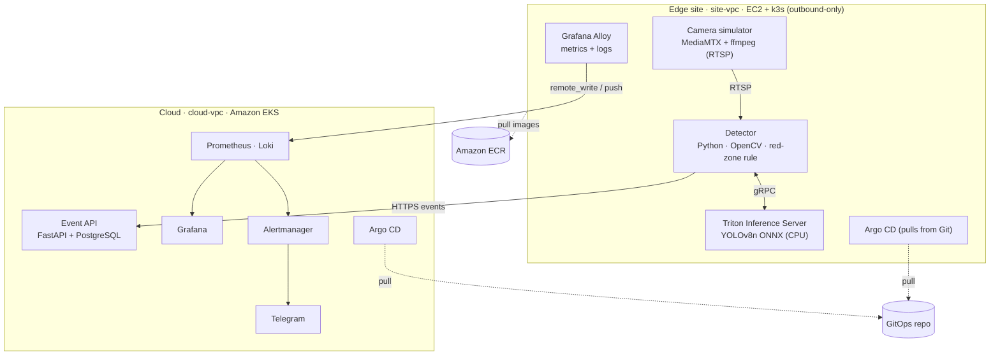
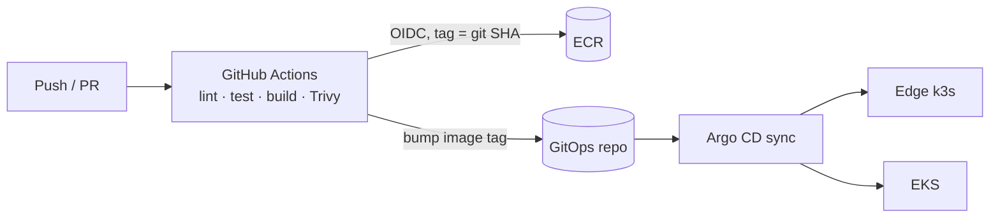

# MiniEyes — Edge AI Video Analytics Platform

> ✅ **Deployed end to end on AWS** (2026-10-25): edge k3s on EC2 running Triton + the detector, events over HTTPS (Let's Encrypt) to an Event API on EKS, metrics and logs via Alloy into Prometheus and Loki, everything delivered by Argo CD from [minieyes-gitops](https://github.com/HuanNguyen09/minieyes-gitops). See [Roadmap](#roadmap) and the operations handbook ([Vietnamese](docs/BAO-CAO-DU-AN.md)).

MiniEyes is a small, end-to-end **edge AI video analytics platform** built to practise running AI workloads the way production edge fleets run them.

A simulated IP camera streams RTSP video to an **edge node**. A detector runs **YOLO on NVIDIA Triton Inference Server** and raises a **"red-zone intrusion"** event when a person enters a configured danger zone. Events, metrics and logs flow to a central **cloud cluster on Amazon EKS**, where Grafana visualises them and Alertmanager routes alerts (Telegram receiver configured; bot token not yet set).

The AI part is deliberately small (a pretrained model). The focus is the **DevOps platform** around it: infrastructure as code, GitOps delivery to edge sites, observability and failure handling.

## Planning

- [Product requirements (PRD)](PRD.md)
- [Issues by milestone](https://github.com/HuanNguyen09/minieyes/milestones): each `type:tdd` issue lists the behaviours to build test-first.

## Architecture



The edge site and the cloud live in **two separate VPCs with no peering**. The edge node only opens outbound connections, mirroring an edge box installed behind a customer's firewall.

### Delivery flow (CI + GitOps)



CI never talks to a cluster. It pushes images to ECR and commits the new tag to the GitOps repo; Argo CD in each cluster pulls the change. Rollback is a `git revert`.

### Layers of responsibility

| Layer | Tool | Scope |
|---|---|---|
| Infrastructure | **Terraform** | S3 remote state, VPCs, EKS (Spot node group), ECR, edge EC2, IAM OIDC role for GitHub Actions |
| Machine configuration | **Ansible** | Edge node hardening, k3s, node_exporter, Argo CD |
| Applications | **Helm + Argo CD** | Detector, Triton, event API, PostgreSQL, monitoring stack |

## Tech stack

**Cloud:** AWS (EKS, EC2, ECR, VPC, IAM, S3) · **IaC:** Terraform, Ansible · **Containers:** Docker, Kubernetes (EKS, k3s), Helm · **CI/CD:** GitHub Actions, Argo CD · **Observability:** Prometheus, Grafana, Loki, Grafana Alloy, Alertmanager · **AI serving:** NVIDIA Triton Inference Server, ONNX · **App:** Python, FastAPI, OpenCV, PostgreSQL · **Security:** Trivy, IAM OIDC, Kubernetes RBAC & NetworkPolicy

## Roadmap

| # | Phase | Status |
|---|---|---|
| 0 | Tooling, AWS budget alarms, least-privilege IAM (boundary, guardrails, no Bedrock), SSM-only dev box | ✅ Done |
| 1 | App: camera simulator, Triton + YOLOv8n, detector, event API (docker compose, 3 e2e tests) | ✅ Done |
| 2 | Containers & Kubernetes: hardened images, Helm charts (70 helm-unittest), NetworkPolicies, Pod Security restricted | ✅ Done |
| 3 | Terraform (VPC, EKS, ECR, edge EC2, OIDC; 41 `terraform test`) + Ansible edge (Molecule, idempotent on the real host) | ✅ Done, applied |
| 4 | Argo CD GitOps to edge and EKS (App of Apps, multi-source, SHA-pinned) | ✅ Done, live |
| 4 | GitHub Actions CI / release / terraform plan | 🟡 Written and actionlint-clean in [`ci/workflows`](ci/workflows); enabling needs a token with the `workflow` scope |
| 5 | Observability: Alloy → Prometheus (remote_write) + Loki, 8 alerts with promtool tests, dashboards as code | ✅ Done, live (Telegram needs a bot token) |
| 6 | Security, drills, runbooks, postmortems | ✅ All 8 [drills](docs/drills.md) run on the live lab (alert times recorded), 2 [postmortems](docs/postmortems/), secret rotation verified; drills found and fixed 4 real issues |

### Failure drills

Camera loss · Triton OOMKilled · bad image tag (ImagePullBackOff) · inference latency regression · edge disk pressure · lost edge connectivity · manual drift vs Argo CD self-heal · accidental destroy in `terraform plan`. Commands, expected alerts and status: [`docs/drills.md`](docs/drills.md); runbooks in [`docs/runbooks/`](docs/runbooks/).

## Repository layout

```text
apps/
  camera-sim/      MediaMTX config + sample video loop
  detector/        RTSP → Triton → red-zone rule → events, Prometheus metrics
  event-api/       FastAPI service storing events in PostgreSQL
  triton/          Triton model repository (YOLOv8n ONNX)
charts/            Helm charts per service
infra/
  terraform/       bootstrap (S3 state), modules, envs/lab
  ansible/         roles for the edge node
observability/     Grafana dashboards (JSON) and Prometheus alert rules
docs/              architecture decisions, runbooks, postmortems
ci/workflows/     CI pipelines (to be moved to .github/workflows/)
```

## Development

Requires [uv](https://docs.astral.sh/uv/) (it installs Python 3.12 automatically).

```bash
uv sync --all-packages          # create .venv with both services and dev tools
uv run pre-commit install       # ruff, whitespace, gitleaks on every commit
make test                       # unit tests + coverage (or run the uv commands in the Makefile)
make lint
```

Without `make` (e.g. Git Bash on Windows): `uv run --package minieyes-detector pytest apps/detector`.

Test markers: unit tests run by default; `-m integration` needs Docker; `-m e2e` needs the compose stack.

### Run the whole stack locally

```bash
# once: export YOLOv8n to ONNX (not committed; AGPL-3.0)
uv run --no-project --python 3.12 --with ultralytics==8.3.40 --with torch==2.5.1 \
    --with torchvision==0.20.1 --with onnx==1.17.0 --with onnxslim==0.1.42 \
    python triton/scripts/export_model.py

docker compose up -d --build --wait     # camera-sim, OVMS, detector, event-api, Postgres
curl -H "X-API-Key: demo-site-01-key" "http://localhost:18000/events?zone=walkway"
curl -s http://localhost:18080/metrics | grep minieyes_
make e2e                                # 3 end-to-end tests, ~2.5 min
```

Locally the model is served by OpenVINO Model Server, which speaks the same KServe v2 protocol
as Triton ([ADR-005](docs/adr/005-ovms-for-local-and-ci-inference.md)); the clusters run Triton.

## Design decisions

- [ADR-001 — Run the lab on AWS](docs/adr/001-aws.md)
- [ADR-002 — Pull-based GitOps for edge sites](docs/adr/002-pull-gitops-for-edge.md)
- [ADR-003 — One Grafana Alloy agent at the edge](docs/adr/003-prometheus-agent-at-edge.md)

## How this project is built

I use **Claude Code** (Claude Max) as a pair engineer, with project skills and MCP tools to scaffold Terraform modules, Helm charts and runbooks. Every change is reviewed by me and validated through `terraform plan`, `helm lint` and CI before it is applied. No secrets or credentials are ever shared with the assistant.

## Running it on AWS

Infrastructure work runs on an SSM-only dev box created once with an admin key
([`infra/aws/devbox`](infra/aws/devbox/README.md)); the laptop only holds an operator profile that can
start, stop and send commands to that box. Order of operations, the traps hit on the first
deploy and the fixes: [`docs/BAO-CAO-DU-AN.md`](docs/BAO-CAO-DU-AN.md) §5–6.

```bash
bash scripts/devbox.sh 'cd ~/minieyes && bash scripts/lab-power.sh up'      # resume the lab
bash scripts/devbox.sh 'cd ~/minieyes && bash scripts/lab-power.sh status'
bash scripts/devbox.sh 'cd ~/minieyes && bash scripts/lab-power.sh down'    # park it overnight
```

## Teardown

`scripts/teardown.sh --yes` (on the dev box) removes the GitOps roots so Argo CD deletes the
Traefik LoadBalancer and workloads, deletes the PVCs, runs `terraform destroy` for
`envs/lab-platform` then `envs/lab`, and finally lists anything still billable (EBS volumes,
load balancers, Elastic IPs, NAT gateways). `bootstrap` (state bucket, budgets) and the dev box
are kept on purpose.

## Cost notes

Measured on the lab (ap-southeast-1, on-demand prices, covered by credits): **running ~0.35 USD/h**
(EKS control plane 0.10, three Spot t3.medium ~0.05, edge m6i.large 0.12, dev box t3.xlarge 0.21
while on, NLB/EBS/public IPv4 the rest); **parked ~0.13 USD/h** (nodes at 0, edge and dev box stopped).
Budget alarms at 30 and 60 USD. Nodes run in public subnets to avoid NAT Gateway cost (ADR-004);
production would use private subnets behind NAT.

## License

[MIT](LICENSE)
