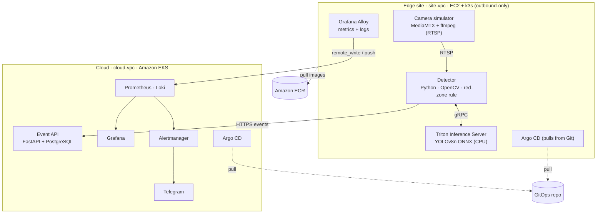
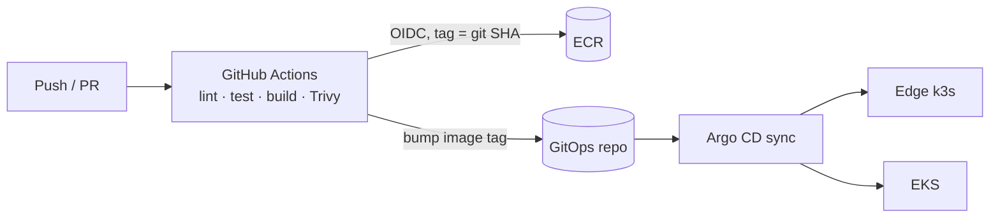

# MiniEyes — Edge AI Video Analytics Platform

> 🚧 **Work in progress** — building in public. Target completion: November 2026. See [Roadmap](#roadmap) for current status.

MiniEyes is a small, end-to-end **edge AI video analytics platform** built to practise running AI workloads the way production edge fleets run them.

A simulated IP camera streams RTSP video to an **edge node**. A detector runs **YOLO on NVIDIA Triton Inference Server** and raises a **"red-zone intrusion"** event when a person enters a configured danger zone. Events, metrics and logs flow to a central **cloud cluster on Amazon EKS**, where Grafana visualises them and Alertmanager notifies **Telegram**.

The AI part is deliberately small (a pretrained model). The focus is the **DevOps platform** around it: infrastructure as code, GitOps delivery to edge sites, observability and failure handling.

## Planning

- [Product requirements (PRD)](PRD.md)
- [Issues by milestone](https://github.com/HuanNguyen09/minieyes/milestones): each `type:tdd` issue lists the behaviours to build test-first.

## Architecture



The edge site and the cloud live in **two separate VPCs with no peering**. The edge node only opens outbound connections, mirroring an edge box installed behind a customer's firewall.

### Delivery flow (CI + GitOps)



CI never talks to a cluster. It pushes images to ECR and commits the new tag to the GitOps repo; Argo CD in each cluster pulls the change. Rollback is a `git revert`.

### Layers of responsibility

| Layer | Tool | Scope |
|---|---|---|
| Infrastructure | **Terraform** | S3 remote state, VPCs, EKS (Spot node group), ECR, edge EC2, IAM OIDC role for GitHub Actions |
| Machine configuration | **Ansible** | Edge node hardening, k3s, node_exporter, Argo CD |
| Applications | **Helm + Argo CD** | Detector, Triton, event API, PostgreSQL, monitoring stack |

## Tech stack

**Cloud:** AWS (EKS, EC2, ECR, VPC, IAM, S3) · **IaC:** Terraform, Ansible · **Containers:** Docker, Kubernetes (EKS, k3s), Helm · **CI/CD:** GitHub Actions, Argo CD · **Observability:** Prometheus, Grafana, Loki, Grafana Alloy, Alertmanager · **AI serving:** NVIDIA Triton Inference Server, ONNX · **App:** Python, FastAPI, OpenCV, PostgreSQL · **Security:** Trivy, IAM OIDC, Kubernetes RBAC & NetworkPolicy

## Roadmap

| # | Phase | Status |
|---|---|---|
| 0 | Tooling, AWS budget alarms, repo skeleton | 🟡 In progress |
| 1 | App: camera simulator, Triton + YOLOv8n, detector, event API (docker compose) | ⬜ Planned |
| 2 | Containers & Kubernetes: multi-stage images, Helm charts, probes, HPA | ⬜ Planned |
| 3 | Terraform (VPC, EKS, ECR, edge EC2, OIDC) + Ansible edge bootstrap | ⬜ Planned |
| 4 | GitHub Actions CI + Argo CD GitOps to edge and EKS | ⬜ Planned |
| 5 | Observability: Alloy at the edge → Prometheus (remote_write) + Loki, dashboards, alerts to Telegram | ⬜ Planned |
| 6 | Security hardening, failure drills, runbooks, postmortem | ⬜ Planned |

### Planned failure drills

Camera loss · Triton OOMKilled · bad image tag (ImagePullBackOff) · inference latency regression · edge disk pressure · lost edge connectivity · manual drift vs Argo CD self-heal · accidental destroy in `terraform plan`. Each one gets a runbook in [`docs/runbooks/`](docs/runbooks/).

## Repository layout

```text
apps/
  camera-sim/      MediaMTX config + sample video loop
  detector/        RTSP → Triton → red-zone rule → events, Prometheus metrics
  event-api/       FastAPI service storing events in PostgreSQL
  triton/          Triton model repository (YOLOv8n ONNX)
charts/            Helm charts per service
infra/
  terraform/       bootstrap (S3 state), modules, envs/lab
  ansible/         roles for the edge node
observability/     Grafana dashboards (JSON) and Prometheus alert rules
docs/              architecture decisions, runbooks, postmortems
.github/workflows/ CI pipelines
```

## Design decisions

- [ADR-001 — Run the lab on AWS](docs/adr/001-aws.md)
- [ADR-002 — Pull-based GitOps for edge sites](docs/adr/002-pull-gitops-for-edge.md)
- [ADR-003 — One Grafana Alloy agent at the edge](docs/adr/003-prometheus-agent-at-edge.md)

## How this project is built

I use **Claude Code** (Claude Max) as a pair engineer, with project skills and MCP tools to scaffold Terraform modules, Helm charts and runbooks. Every change is reviewed by me and validated through `terraform plan`, `helm lint` and CI before it is applied. No secrets or credentials are ever shared with the assistant.

## Cost notes

The lab runs on AWS credits and is torn down with `terraform destroy` when not in use. Budget alarms are set at 30 and 60 USD. Nodes run in public subnets to avoid NAT Gateway cost; this is a lab trade-off, and production would use private subnets behind NAT.

## License

[MIT](LICENSE)
